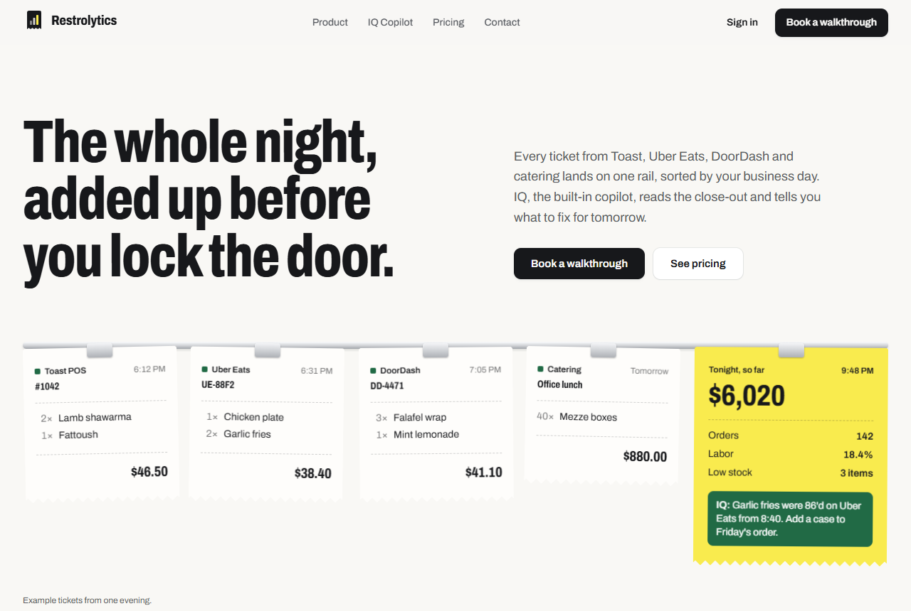
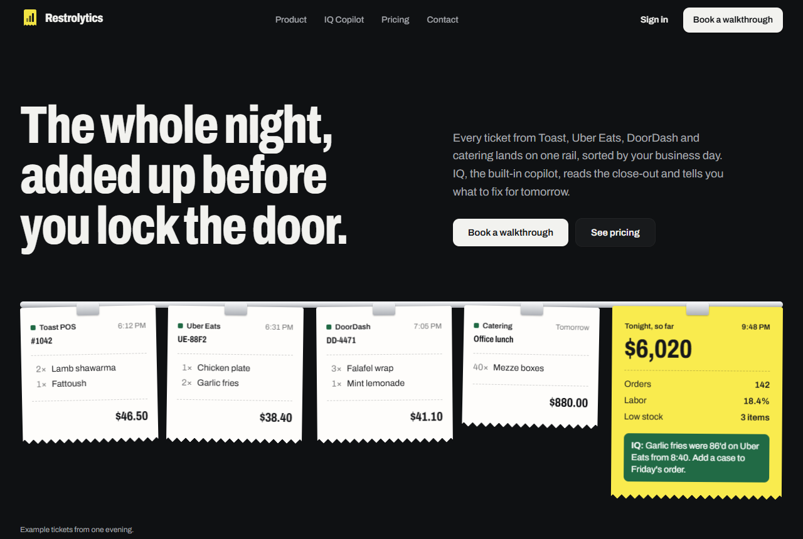
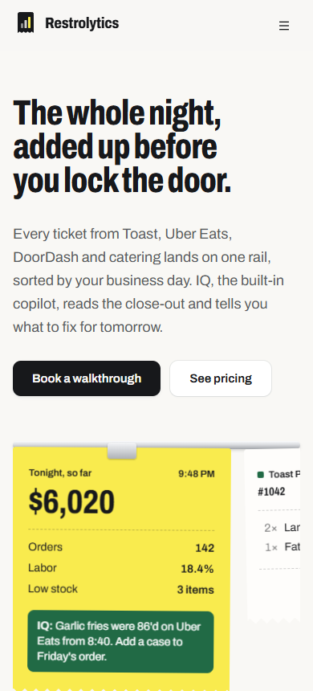
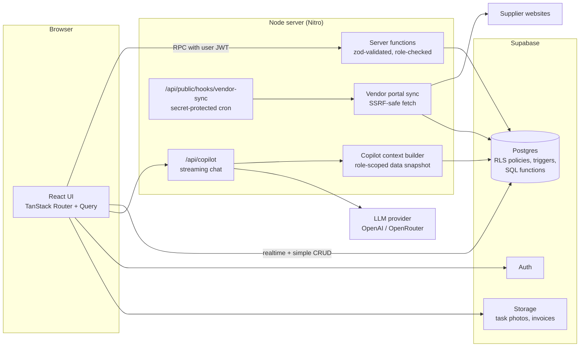

# Restrolytics

**Restaurant operations software for independent restaurant owners.** Sales from the POS and delivery apps, inventory and vendor orders, shift checklists, timeclock and payroll live in one app, with **IQ**, an AI copilot that answers questions from the restaurant's own data.

The question it answers every night: _what happened today, and what should I fix for tomorrow?_



<table>
  <tr>
    <td width="62%"></td>
    <td width="38%"></td>
  </tr>
</table>

---

## Contents

- [Why I built it](#why-i-built-it)
- [Features](#features)
- [Tech stack](#tech-stack)
- [Architecture](#architecture)
- [Engineering highlights](#engineering-highlights)
- [Design system](#design-system)
- [Testing and quality](#testing-and-quality)
- [Running it locally](#running-it-locally)
- [Project structure](#project-structure)
- [Status and roadmap](#status-and-roadmap)

---

## Why I built it

A small restaurant's numbers are spread across half a dozen places: the Toast POS, Uber Eats and DoorDash dashboards, supplier websites, paper invoices, a payroll spreadsheet and a group chat for checklists. Owners close at 1 AM and still can't answer simple questions like "why was labor so high on Tuesday?"

Restrolytics pulls those sources into one Postgres database, sorts everything by the restaurant's **business day** (a shift that closes at 1 AM still counts as Friday), and puts an AI copilot on top that can only see that restaurant's data.

## Features

**For owners and managers**

| Area                      | What it does                                                                                                                                                            |
| ------------------------- | ----------------------------------------------------------------------------------------------------------------------------------------------------------------------- |
| **Dashboard**             | Today's sales, orders and low stock, a 7-day sales chart, channel share, recent orders and the end-of-day report                                                        |
| **Sales**                 | Imports Toast sales summaries (Excel) and Uber Eats payment, order-error and ratings reports; per-channel pages; catering orders with payments                          |
| **Inventory**             | Vendors with order days, stock counts by storage area on a phone, low-stock alerts, invoice photos read by AI, and order-history sync from WooCommerce supplier portals |
| **Shifts**                | Opening and closing checklists for front of house and kitchen, with temperatures, notes and photo proof; the schedule; shift reminders                                  |
| **Timeclock and payroll** | Staff clock in from their phone; weekly pay sheets; tip pools split by hours worked; paid weeks lock; staff confirm when they've been paid                              |
| **Team access**           | Invite managers by email; create username logins for staff who have no email address                                                                                    |
| **IQ Copilot**            | Streaming chat that answers from the restaurant's sales, schedule, stock and payroll, and says so when the data isn't there                                             |
| **Manager console**       | Internal staff (a "virtual manager" plan) can work across client restaurants with chat, tasks and notes                                                                 |

**For staff:** their own shifts, checklists, timeclock, hours and pay, and nothing else. Staff never see revenue or other people's pay.

**Public website:** landing page, pricing, contact, privacy and terms, with SEO metadata, `sitemap.xml`, `robots.txt`, JSON-LD and a generated share image.

## Tech stack

| Layer            | Choice                                                                                                              |
| ---------------- | ------------------------------------------------------------------------------------------------------------------- |
| Framework        | [TanStack Start](https://tanstack.com/start) (React 19, file-based routing, server functions, SSR)                  |
| Build and server | Vite 8, Nitro (portable Node server; Vercel, Netlify or Cloudflare by preset)                                       |
| Data             | Supabase: Postgres, Row Level Security, Auth, Storage, Realtime                                                     |
| Data fetching    | TanStack Query                                                                                                      |
| Validation       | Zod on every server function input                                                                                  |
| AI               | Vercel AI SDK with a pluggable provider (OpenAI or OpenRouter); streaming chat and structured extraction            |
| UI               | Tailwind CSS v4 with oklch design tokens, shadcn/ui (Radix), lucide icons, Recharts                                 |
| Type             | Archivo variable font (weight and width axes), self-hosted                                                          |
| Testing          | Vitest, PGlite (Postgres in WebAssembly) for database tests, Playwright, axe-core, Lighthouse                       |
| CI               | GitHub Actions: lint, typecheck, unit and database tests, contrast check, build, end-to-end and accessibility tests |

## Architecture



- **Two layers of access control.** Every request runs as the signed-in user, so Postgres Row Level Security limits what each person can read or write. Server functions add role checks (`requireManager()`) for manager-only actions. Hiding a button is never the access control.
- **Multi-tenant by restaurant.** Every row belongs to a restaurant; policies check membership and role per restaurant, and triggers stop rows from being moved between restaurants.
- **Copilot without tools.** Instead of letting the model call database tools, the server builds a role-scoped snapshot of the restaurant's numbers and puts it in the prompt. Staff isolation is enforced before the model sees anything, and answers stay grounded in real figures.
- **Heavy maths in SQL.** Daily sales, low stock and count completion run as Postgres functions, so totals are exact and never truncated by API row limits.

## Engineering highlights

Problems I found while hardening the app, and how they were solved.

**Security**

- **Staff could edit their own pay.** The original policies let a staff member update `payroll_lines.total` and their own clocked minutes. Staff now acknowledge pay through a `SECURITY DEFINER` function that changes one column, hours are computed server-side, and paid weeks are locked by a trigger.
- **Webhook "authenticated" by a public key.** The vendor-sync endpoint now requires a dedicated secret, compared in constant time, and returns only aggregate counts.
- **Server-side request forgery.** Managers can save a supplier's website for order sync, so the server fetches user-supplied URLs. Fetches only allow public `https` hostnames, resolve DNS once, reject private, loopback, link-local and mapped IPv6 ranges, and pin the connection to the vetted IP so DNS rebinding can't swap the target between check and connect. Redirects are capped and re-validated.
- **Cross-tenant writes.** Inventory counts, checklist completions, payroll hours and integration secrets were each checked for "can this user touch a row in another restaurant?" and closed with ownership checks and same-restaurant triggers.
- **Account takeover via invites.** Invites to the internal staff-login domain are blocked, invite emails use a configured site URL instead of the request's `Host` header, and invite results don't reveal whether an email exists.

**Correctness**

- **Business day, not calendar day.** A restaurant open 5 PM to 2 AM has one service, not two. `operating-day.ts` maps any instant to the restaurant's business day in its own timezone, including daylight-saving days with 23 or 25 hours, and reporting queries use those UTC bounds.
- **Low stock was always zero.** A query compared a column to the string `"reorder_level"`. It's now a SQL function comparing the actual columns.
- **Counts overwrote total stock** with one storage area's count. Completing a count now sums every location in one transaction.
- **Clock records were deleted** when a manager edited hours. Edits are now stored as separate adjustment rows, keeping the audit trail.

**Product**

- **Staff without email.** Many kitchen staff don't have a work email. Managers create a username and temporary password; the app signs them in as `username@kaizr.staff` behind the scenes, with no email ever sent.
- **Honest AI states.** If no AI provider is configured, Copilot and invoice reading say so instead of failing.

## Design system

The visual language is a **manager marking up the night's printout**:

| Token        | Colour    | Used for                                                                                   |
| ------------ | --------- | ------------------------------------------------------------------------------------------ |
| Paper        | `#F9F8F5` | Page background; cards are white                                                           |
| Ink          | `#17181B` | Text and primary buttons                                                                   |
| Highlighter  | `#FAEB4E` | The one thing that matters on a screen: the close-out ticket, the active page, today's bar |
| Ledger green | `#216A45` | Annotations: links, focus rings, IQ's notes, earlier days in charts                        |

- The hero is a **ticket rail**: kitchen order tickets with torn edges clipped to a steel rail, ending in a yellow close-out ticket. The dashboard's "Sales today" card is the same ticket.
- All colours are oklch tokens in [`src/styles.css`](src/styles.css), with a full dark theme ("the same printout under a desk lamp").
- `npm run check:contrast` converts every token pair to sRGB and fails the build if any text drops below WCAG AA.
- The chart palette was checked for colour-vision deficiency in both themes.
- Type is Archivo only: condensed widths for headlines and figures (like a printed ticket), normal width for body text, tabular numbers everywhere.

## Testing and quality

| Check                                       | What it covers                                                                                                                                                                                                                         |
| ------------------------------------------- | -------------------------------------------------------------------------------------------------------------------------------------------------------------------------------------------------------------------------------------- |
| **Unit tests** (Vitest, 36)                 | Business-day maths across overnight service and daylight saving, pay-week dates, vendor reorder timing, the Toast workbook parser, date-range presets, URL and IP safety checks                                                        |
| **Database tests** (PGlite, 18)             | Runs every migration in an in-memory Postgres with Supabase auth stubs, then acts as real users to prove the policies: staff can't change their pay or hours, one restaurant can't read or write another's rows, paid weeks are locked |
| **End-to-end** (Playwright, 18 × 2 devices) | Public pages render with no console errors or sideways overflow on desktop and mobile; signed-out users are redirected from the dashboard; 404s; `robots.txt` and `sitemap.xml`                                                        |
| **Accessibility** (axe-core)                | WCAG 2.1 A/AA checks on public and auth pages in light and dark mode                                                                                                                                                                   |
| **Lighthouse** (mobile, production build)   | Accessibility 100, Best Practices 100, SEO 100, Performance 81–83                                                                                                                                                                      |
| **Contrast**                                | Every design-token text pair meets WCAG AA in both themes                                                                                                                                                                              |

```bash
npm test             # unit + database tests
npm run test:e2e     # Playwright + axe (builds the app first)
```

## Running it locally

**Requirements:** Node 22, and a Supabase project (the free tier is fine).

```bash
git clone https://github.com/Husaam1105/Restrolytics.git
cd Restrolytics
npm install
cp .env.example .env   # add your Supabase URL and keys
npm run dev            # http://localhost:8080
```

Creating the database, applying migrations, enabling Google sign-in and adding the first platform-staff account are covered step by step in [docs/setup.md](docs/setup.md).

AI features are optional. To turn them on, set `AI_PROVIDER` (`openai` or `openrouter`), `AI_API_KEY` and the model names listed in [`.env.example`](.env.example).

### Scripts

| Command                  | What it does                                  |
| ------------------------ | --------------------------------------------- |
| `npm run dev`            | Dev server with hot reload                    |
| `npm run build`          | Production build into `.output/`              |
| `npm start`              | Run the built Node server                     |
| `npm run typecheck`      | TypeScript, no emit                           |
| `npm run lint`           | ESLint and Prettier                           |
| `npm test`               | Unit and database tests                       |
| `npm run test:e2e`       | Playwright end-to-end and accessibility tests |
| `npm run check:contrast` | WCAG contrast check on the design tokens      |
| `npm run build:og`       | Regenerate the share image and touch icon     |

### Deploying

The build produces a portable Node server (`node .output/server/index.mjs`). To target a platform, set `NITRO_PRESET` at build time (`vercel`, `netlify`, `cloudflare-module`) and copy the variables from `.env.example`. Set `SITE_URL` to the public address so invite and password-reset links point to the right place.

## Project structure

```
src/
  routes/                 file-based routes
    index.tsx             public landing page (plus pricing, contact, legal, auth)
    _authenticated/       the signed-in app: dashboard, sales, inventory, shifts, payroll, copilot
    api/                  streaming copilot endpoint and the vendor-sync webhook
  components/             app and marketing components; ui/ holds shadcn primitives
  lib/
    *.functions.ts        server functions called from the UI (validated, role-checked)
    *.server.ts           server-only code: AI, copilot context, vendor sync, SSRF-safe fetch
    operating-day.ts      business-day and timezone maths
    *.test.ts             unit tests next to the code they cover
  styles.css              design tokens and type scale
supabase/migrations/      schema, RLS policies, triggers and SQL functions (26 migrations)
tests/db/                 PGlite harness and row-level-security tests
e2e/                      Playwright smoke and accessibility tests
scripts/                  contrast checker, share-image generator
docs/setup.md             full setup guide
```

The product rules the code relies on, such as payroll being per employee and combined pay ranges being read-only, are written down in [AGENTS.md](AGENTS.md).

## Status and roadmap

**Working today:** everything listed under [Features](#features), the public website, and the test suite above.

**Next:**

- DoorDash and Grubhub report import (the importer is written for Uber Eats; the other channels currently take manual entries)
- Menu and recipe costing, guest records, and a manager log
- An onboarding flow for a restaurant's first login, first staff member and first upload
- Error monitoring (the reporting hook in `src/lib/error-reporting.ts` is ready for Sentry)

---

Built by **Mohammed Husaamuddin Ahmed** ([@Husaam1105](https://github.com/Husaam1105)).
